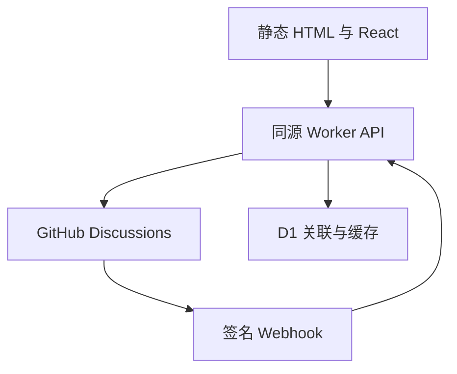

# 架构、API 与数据边界

## 请求与持久化

构建时把 Markdown 转为消毒后的 HTML 和稳定块数据，再对所有公开路由渲染完整 HTML。客户端阅读模块单独分包，进入文章前加载；服务端预渲染直接使用该组件，绝不把 Suspense 占位当正文交付。

Workers Static Assets 优先处理文章和图片；`/api/*` 才 `run_worker_first`。没有 SPA 404 fallback，未知文章由真实 404 文档处理。`_headers` 对静态内容设置 CSP 等安全头；API 自己设置响应头。前端构建不接收任何带密钥的 VITE_* 环境变量。

## API

| 方法 | 路径                                                   | 说明                                                 |
| ---- | ------------------------------------------------------ | ---------------------------------------------------- |
| GET  | `/api/status`                                          | 只返回配置就绪状态，不返回配置值                     |
| GET  | `/api/session`                                         | 当前身份与 CSRF Token；未登录返回 user:null          |
| GET  | `/api/auth/github?return=...`                          | 一次性 state、PKCE，跳转 GitHub                      |
| GET  | `/api/auth/callback`                                   | 验证 state，交换用户 Token，建立 HttpOnly 会话       |
| POST | `/api/logout`                                          | 同源、会话、CSRF 校验后撤销会话                      |
| GET  | `/api/feed/comments?ids=...`                           | 最多 20 篇，批量查询每篇最近两条主评论               |
| GET  | `/api/echo`                                            | 最近真实站内提交，跳过已删除内容                     |
| GET  | `/api/posts/:id/comments?after=...`                    | 每页 20 条主讨论，附前 3 条回复                      |
| GET  | `/api/posts/:id/comments/:commentId`                   | 批注深链定点读取，校验所属 Discussion                |
| GET  | `/api/posts/:id/comments/:commentId/replies?after=...` | 每页 20 条回复                                       |
| GET  | `/api/posts/:id/annotations?after=...`                 | 每页 100 个批注元数据，向 GitHub 验证存在性          |
| POST | `/api/posts/:id/comments`                              | 用户 Token 发表，支持 anchor、replyToId 和 requestId |
| POST | `/api/webhook/github`                                  | HMAC SHA-256 校验、缓存失效、删除同步                |

UI 的“条讨论”数量指 GitHub 顶层 DiscussionComment 数量；回复在各线程内单独分页计数，不把一个不完整的回复合计伪装为总评论数。

## D1 表

| 表            | 存什么                                                    | 不存什么                  |
| ------------- | --------------------------------------------------------- | ------------------------- |
| posts         | 稳定 ID、slug、标题、当前内容版本                         | 文章正文仍在 Git Markdown |
| discussions   | 文章 ID 与真实 Discussion ID/number/URL                   | 不伪造节点 ID             |
| annotations   | GitHub comment ID 与 selector JSON                        | 不代替 GitHub 评论正文    |
| api_cache     | 最长 60 秒的新鲜展示缓存，最多 15 分钟故障缓存            | 不是正文权威来源          |
| sessions      | Cookie 哈希、用户身份、AES-GCM 加密 Token、CSRF、到期时间 | 不存明文 OAuth Token      |
| oauth_states  | state 哈希、加密 verifier、安全返回路径、10 分钟过期      | 不接受任意外部返回地址    |
| rate_limits   | 短期哈希桶与原子计数                                      | 不长期保存原始 IP         |
| write_intents | 提交 ID、payload 哈希、状态与 GitHub 结果 ID              | 不把本地成功当成远端成功  |

每日定时清理过期会话、OAuth 状态、限流桶、过期缓存和超过 90 天的提交意图。永久批注不随清理删除。

### 已发布文章、永久链接与 D1 自动对账

- 发布后的 `post.id` 不变；后台更改 `slug` 时，与 Markdown 同次提交更新 `public/_redirects` 的 301 规则。重复更名将旧来源直接指向当前地址；旧来源不允许被另一篇文章占用。Workers Static Assets 原生执行这些规则，前端不拦截不存在于当前文章清单的链接。
- GitHub/Cloudflare Workers Builds 仅负责构建和 Worker 部署，**不自动执行** `wrangler d1 execute`。Worker 在部署后首个具备 D1 的 API 请求、及每天的定时任务，以打包进 Worker 的 manifest 校准 `posts` 的 slug、title、version；变更在 D1 batch 中原子执行，允许两篇文章互换 slug。
- 同步失败记录不含个人信息的 `post_catalog_sync_failed` 事件，评论 API 继续按现有数据服务，并在后续请求重试；运维需查看 Worker Logs。文章删除或下架后，D1 历史记录、稳定 `id`、Discussion 和批注关联仍保留；若当前已发布文章需要使用历史 `slug`，同步会在**同一事务内**将原历史行改用 `__retired__<post.id>` 内部占位 slug，再为现行文章分配该地址。占位名包含下划线，不可能成为公开文章 slug。这个过程不删除关联数据；恢复原文章时使用同一个 `id` 可重新绑定其公开 slug。
- 手动部署运行迁移后直接部署 Worker，自动对账取代部署前的 D1 SQL 写入。现有 `db:sync:remote` 命令保留给人工校验、恢复，以及**首次手动导入新增文章的 Discussion 映射之前**建立外键目标；手动进行 slug 互换时避免使用旧版单阶段 SQL。

每日定时清理不会删除旧文章的讨论或批注。

## 发表评论与不确定结果

1. 服务端确认同源、用户会话、CSRF、文章、原文定位、Discussion 公共仓库归属和回复对象。
2. 原子保留 requestId 与 payload 哈希。已成功的相同请求直接读取原结果；相同 ID 配不同正文被拒绝。
3. 只使用该用户自己的 OAuth Token 调用 addDiscussionComment。隐藏 HTML 注释携带文章 ID、requestId 和可恢复 selector。
4. GitHub 返回后，在 D1 batch 中保存 selector、标记发送成功并失效该文章缓存。
5. 如果网络断在 GitHub 写入之后，状态为未确认；下次以同一 requestId 在最近 100 个根评论及各自最近 100 个回复中寻找隐藏标记。找到后补齐 D1，绝不自动再发一条。

这个恢复窗口适合个人博客。超过窗口、用户删除了隐藏标记、仓库在请求期间被锁定或网络始终失败时，需在 GitHub 原讨论确认，不能承诺分布式系统中的无限次“恰好一次”。UI 保留草稿并清楚提示未确认。

## 持久划线

selector 包含 schema、postId、version 与多个 segment。每段保存 blockId、TextQuoteSelector(exact/prefix/suffix) 与 TextPositionSelector(start/end)。UTF-16 位置与浏览器 DOM Range 一致。

定位顺序：准确原文匹配 → 同版本稳定位置 → 前后文与稳定块 ID 得分 → 拒绝歧义。不会模糊替换成另一句“类似的话”。跨段选择必须所有段都定位成功，否则整条批注进入无法定位状态。多个高亮先分割成不重叠区间，再对实际文本节点加 mark，每个 mark 保留所有关联 ID，内联粗体与链接结构不被拆坏。

公开选择的引用来自 GitHub 评论对应的 D1 元数据；推荐流、批注深链、原文高亮和讨论引用使用同一 comment ID。个人划线是明确说明的本机功能，与公开批注持久化区分。

## 缓存与同步

GitHub 读取按文章、分页游标、讨论 ID 缓存。本人提交后立即失效该文章缓存；Webhook 编辑/删除后同样失效。没有 Webhook 时正常刷新最多落后 60 秒。只在临时上游失败时允许带 stale 标记的旧缓存；删除、权限不足和私有仓库不会主动触发故障缓存回退。

安全配置变更应同时清理对应缓存；将曾公开的仓库改为私有时，应立即停用公开 API 或清理缓存，因为任何 TTL 缓存都有生效窗口。本项目要求专用的公开 Discussions 仓库。

## 扩展与运维

- 评论权限与屏蔽以 GitHub 为准；代码不提供越权编辑/删除。
- API 错误只记录路径和错误码，不记录请求 Header、Token、OAuth code 或评论文本。
- Cloudflare D1 备份及 GitHub 仓库是运维备份边界；不要仅依赖浏览器保存批注关系。
- 自定义域名必须保持同源，Cookie 不跨 workers.dev 与自定义域共享。
- 正式 OAuth、GitHub 配额和 Cloudflare 域名证书需要部署后的真实环境验收。

## 可双击的离线构建

`src/offline.tsx` 经 Vite library build 输出单一 IIFE，CSS、SVG 与 RSS 一并内嵌到 `preview/index.html`。该文件用 file:// 直接执行，采用 fragment 地址，不要求本地服务器。正式客户端仍保留独立 URL 与按需阅读模块。

预览有清晰的离线标记；只读状态返回“未连接”，公开登录和发帖不可用。私人划线、搜索、筛选、阅读与主题是真实的本地交互。所有公开评论在正式 HTTP 部署中继续走原来的 Worker/GitHub/D1 链路。

已有文章 ID、批注 ID、深链前缀和存储键保持兼容。ECHO 仅作为早期工程的数据命名空间保留，不再作为对外站名。实际域名仍须由站长填写完整 FQDN，不能把 Waylan 自动猜作某个 .com 或 .cn 地址。
