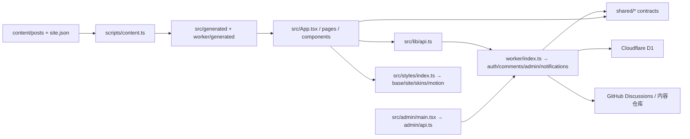
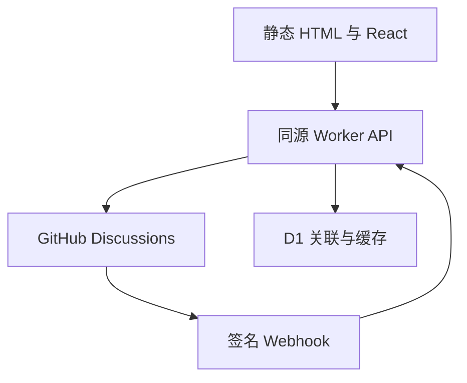

# 架构、API 与数据边界

## 模块职责与故障定位地图（维护规划，2026-11-05）

> 本节区分 **当前代码已存在的事实** 和 **未来渐进改造的目标**。现有 API、数据库和离线预览契约仍以本文后半部分为准。本节只规定维护边界，不代表下述建议目录已经实施。操作、PR、记录模板见 [维护手册](MAINTENANCE.md)。

### 当前请求链和依赖方向



- **浏览器路由及页面装配**：`src/App.tsx`、`src/pages.tsx`、`src/pages/*`。`src/components/*` 实现 UI，`src/lib/*` 提供面向浏览器的路由、动效、公共 JSON API、选区和本地持久化能力。
- **后台**：`src/admin/main.tsx`（现有界面聚合）与 `src/admin/api.ts`（保留认证、CSRF、专有超时）；与公开浏览 API `src/lib/api.ts` 是两个明确的访问场景，**不为了“统一”混用后台凭据和缓存**。
- **服务端**：`worker/index.ts` 只组织入口及路由；`worker/auth.ts`、`security.ts`、`comments.ts`、`admin.ts`、`notifications.ts`、`views.ts` 分别管理相关责任；跨端合同放 `shared/*`。
- **数据生产线**：`content/*` 为文章/站点配置源；`scripts/content.ts` 构建 `src/generated/*` 与 `worker/generated/*`；不要直接手改生成产物、历史 D1 migrations 或已发布的 `post.id`。
- **样式与动效**：`src/styles/index.ts` 是正式/离线共用的字体和 CSS 导入顺序；`src/styles.css`、`src/styles/site.css`、`src/styles/skins.css`、`src/styles/motion.css` 是当前四类规则集合；运行时动画策略在 `src/lib/motion.ts`。
- **验证和部署**：`tests/*` 是单测与契约测试；`scripts/*-smoke.mjs` 为真实浏览器审核；`.github/workflows/verify.yml` 是唯一 GitHub Actions 入口，按 `scripts/ci-plan.mjs` 选择检查。

依赖应单向：`App / pages → components → lib → shared`；`worker 路由 → worker 业务模块 → shared`。`shared` 不应依赖 React、浏览器 DOM、Worker 运行时、GitHub 客户端或 D1；前端业务代码不得直接连接 D1、使用服务器 Token，服务端也不得 import 浏览器组件。跨端交互走版本稳定的 HTTP/共享类型，不允许跨功能深层 import 内部私有实现。

### 从问题直接找到文件

**先查入口模块和相邻依赖，再扩大搜索范围。** 表中是排查起点，不保证每次故障都由该文件引起。涉及数据、权限、生成文件时按请求链向上或向下追踪。

| 用户反馈 / 故障类型 | 第一定位路径 | 关联检查（仅在影响范围内运行） |
| --- | --- | --- |
| 三端两主题排版、标题换行、导航或留白 | `src/styles.css`、`src/styles/site.css`、`src/styles/skins.css`；组件 DOM 在 `src/App.tsx` / `src/components/Feed.tsx` / `Reader.tsx` | `tests/mobile-regressions.test.ts`、`tests/skin-parity.test.ts`、`scripts/visual-smoke.mjs`、`scripts/responsive-navigation-smoke.mjs` |
| 搜索、URL 筛选、排序、返回位置 | `src/pages/Feed.tsx`、`src/components/Feed.tsx`、`src/lib/router.tsx`、`src/App.tsx` | `tests/navigation.test.ts`、`scripts/interaction-state-smoke.mjs` |
| 文章阅读、目录、代码块、图片放大 | `src/components/Reader.tsx`、`MarkdownTools.tsx`、`src/lib/reader-loader.ts` | `scripts/reader-deep-smoke.mjs`、`scripts/quality-smoke.mjs` |
| 长按选区、私人划线、批注定位与分享 | `src/components/Reader.tsx`、`src/lib/selection.ts`、`shared/anchors.ts` | `tests/selection.test.ts`、`tests/anchors.test.ts`、`scripts/selection-composer-smoke.mjs` |
| 评论加载、提交、重试及缓存 | `src/lib/api.ts`、`worker/comments.ts`、`worker/github.ts`、`worker/auth.ts` | `tests/worker.test.ts`、`tests/transport.test.ts`；必要时跑阅读器浏览器检查 |
| 登录、CSRF、安全头和权限 | `worker/auth.ts`、`worker/security.ts`、`worker/index.ts`、`worker/types.ts` | `tests/worker.test.ts`、`tests/github-app-config.test.ts` |
| 后台编辑、媒体上传、站点设置 | `src/admin/main.tsx`、`src/admin/form.ts`、`src/admin/api.ts`、`worker/admin.ts`、`shared/content-rules.ts` / `uploads.ts` | `tests/admin.test.ts`、`tests/admin-form.test.ts`、`scripts/quality-smoke.mjs` |
| 文章新增、永久链接、RSS 和预渲染 | `content/*`、`scripts/content.ts`、`scripts/prerender.tsx`、`shared/redirects.ts`、`worker/post-sync.ts` | `tests/post-sync.test.ts`、`tests/redirects.test.ts`、`scripts/check-build.ts` |
| 深浅主题、editorial / terminal 和动效 | `src/styles/skins.css`、`src/styles/motion.css`、`src/lib/appearance.ts`、`src/lib/motion.ts` | `tests/skin-parity.test.ts`、`tests/motion.test.ts`、`scripts/quality-smoke.mjs` |
| 通知状态、阅读清单与浏览量 | `src/components/NotificationBell.tsx` / `Shelf.tsx`、`src/lib/shelf.ts` / `views.ts`、`worker/notifications.ts` / `views.ts` | 相关单测、`scripts/quality-smoke.mjs` |
| Actions 消耗、测试分类与手动运维 | `.github/workflows/verify.yml`、`scripts/ci-plan.mjs`、`scripts/maintenance.test.mjs`；策略见 `docs/ops/ACTIONS_POLICY.md` | `node --test scripts/maintenance.test.mjs`，必要时手动全套 CI |
| 部署、D1 迁移与仓库转私有 | `wrangler.jsonc`、`scripts/validate-deploy.ts`、`migrations/*`、`worker/auth.ts`；清单见 `docs/MAINTENANCE.md` | `npm run check`、真实 Worker 验证、受控发布与回滚检查 |

### 阅读器拆分第一批（本分支已实施，待 CI 验收）

阅读器的公开入口仍为 `src/components/Reader.tsx`，由 `src/lib/reader-loader.ts` 按需加载；路由、全文状态、提交、Touch 选区和评论写入协议保持原位。新增两个**按功能划分**的入口：

| 功能 | 稳定入口 | 内部实现及责任 |
| --- | --- | --- |
| 文章头部与目录 | `src/features/reader/index.ts` | `ArticleHeader.tsx`（文章元信息和返回动作）、`ReaderToc.tsx`（目录/阅读进度/状态展示）、`ImageViewer.tsx`（图片放大与退出动画保留） |
| 公开评论显示 | `src/features/discussions/index.ts` | `CommentItem.tsx`（回复分页、编辑/删除按钮）、`CommentMarkdown.tsx`（公开评论与草稿共用的安全 Markdown）、`model.ts`（空评论过滤与 GitHub URL 限制） |

- `CommentItem` 通过 `postId`、`comment`、`onReply`、`onQuote`、`onChanged` 等显式输入接收上下文，**不再**使用 `useRouter` 和全局文章表猜测当前文章；递归回复沿用同一 `postId`。新增评论能力可优先修改 `features/discussions` 而不修改导航逻辑。
- `ReaderToc` 从父组件接收当前段落、阅读进度和控制回调；实际 DOM 位置与跳转时机仍由 `Reader` 负责，避免目录直接操作不属于它的生命周期。
- 组件对外渲染结构、CSS class、永久链接、评论 API、D1、离线预览和动效策略不变。未新增第三方 UI / 动画 / 状态管理依赖。
- CI 的 `scripts/ci-plan.mjs` 已将 `src/features/reader/`、`src/features/discussions/` 及后续 `annotations/` 映射至阅读器相关 QA；新功能只需接入对应入口及契约测试，不必创建新工作流。
- 当前 Reader 仍含选区与评论编辑器的复杂生命周期；**未擅自将这些状态强拆**。后续要抽离其中一个必须先建立独立行为基线，重点覆盖 Safari 长按、评论草稿恢复和错误提交重试。

### 目标模块组织（渐进方案，**仅部分实施**）

先在现有组件内确认独立状态和事件边界；有必要时逐个功能迁移到以下目录，而不是一次迁移整个项目。示意：

```text
src/
  app/                 路由装配、页眉/搜索/全站状态（从 App 局部提取）
  pages/               保留独立页面和稳定路由入口
  features/
    reader/            阅读容器 / 目录 / 封面 / 阅读进度
    annotations/       选区、私人划线、定位、浮动工具
    discussions/       评论 UI、草稿、分页与发送状态
    feed/              列表、筛选、排序与推荐
    admin/             后台编辑器、站点编辑、内容列表
  lib/                 跨功能且与业务无关的轻量基础能力
  styles/              tokens / base / layout / features / skins / motion
worker/
  index.ts             入口与路由分发
  auth.ts / security.ts / ...    原有服务边界先保持
shared/                跨前后端的类型、定位、输入规则
```

**迁移规则：** 只在改动相应功能且有验证环境时动一块；外部继续通过稳定的模块入口引用；内部实现原则上不跨功能深层导入。若出现为复用两行代码而创建新的三层抽象，通常应保留局部实现；真正共用且策略一致的能力再提升至 `lib/` 或 `shared/`。

建议优先顺序及约束：

1. **P0｜建立地图和变更记录（已完成）**：为模块建立归属、影响半径、异常定位和维护报告，无业务改动。
2. **P1｜阅读器拆分（第一批已迁移）**：原 `src/components/Reader.tsx` 约 2,234 行，首批抽出文章头部、目录、图片放大和评论显示；保留 `Reader({ post })` 外部签名、评论 ID、批注锚点和返回行为。复杂的触摸选区、评论草稿及发送状态留待单独验证的下一批，不以行数为唯一目标。
3. **P2｜后台编辑器拆分**：`src/admin/main.tsx` 约 1,286 行；按 PostEditor、SiteEditor、Dashboard 拆分，不重新实现已有的 `admin/api.ts`、表单规则与上传事务。
4. **P3｜CSS 归属与级联清理**：四份主要 CSS 文件共约 216 KB；先建立样式选择器→所属组件表，减少重复覆盖，再逐组移入明确位置。不能批量搬移改变 `src/styles/index.ts` 的加载顺序、层叠优先级、媒体查询和两个 skin 的尺寸一致性；所有布局修改必须实际验证手机、平板、桌面、明暗主题。
5. **P4｜Worker 读写职责分离**：`worker/comments.ts` 和 `worker/admin.ts` 的鉴权、校验、GitHub 传输、缓存、幂等写入边界明确后，再按单一职能抽取实现。**不得**同时改 HTTP 协议、D1 迁移、OAuth 安全约束及评论的重复提交恢复语义。
6. **P5｜测试维护结构**：`tests/navigation.test.ts` 等大文件可按功能和夹具拆分，但先锁定测试数、场景与历史缺陷清单；拆分后不得少测。`scripts/ci-plan.mjs` 应随入口移动同步更新，否则会误判变更范围。

行数是**审查信号，不是重构 KPI**。可以用“文件是否只有一个清晰的变更理由”“一次修改影响哪些功能”“能否单独回滚”判断是否应该拆分。避免把 1 个大文件机械切成 30 个相互依赖的小文件。

### 依赖图算法与智能化边界

- 优先使用简单、确定性且可审计的依赖图：TypeScript import / export 与动态加载入口构成有向图；用拓扑排序判断层级，用强连通分量（如 Tarjan）识别循环依赖，用有限深度遍历寻找 PR 变更的影响范围。
- 图谱可在**结构变更/定期审计**时生成，保存版本和生成时间；平时故障按上面的定位表寻找责任目录，不要求每次全仓扫描。
- 神经网络/AI 可用于**提示可能关联的模块、总结异常和建议测试**，不得代替确定性的依赖解析、类型检查、权限判断和合并门禁。当前项目没有必要因此引入新的运行时 AI 框架或服务费用。
- 后续如实现依赖图生成器，先给它设定可验证的目标：没有漏掉静态依赖、循环依赖有报告、动态 import 需要人工标记、报告可追溯到 commit；未达到要求不将其作为自动决定 QA 的依据。

### 验收指标与不可变契约

每次结构性 PR 必须有基线及对比：相关测试不减少、前端预渲染/离线预览不回退、API 状态码/错误合同不漂移、`post.id` / Discussion / annotation / OAuth / D1 数据兼容、两皮肤两主题关键布局坐标不改变（除非目标明确要求）。记录首次定位时间、跨模块修改数量、复发率、受影响文件和 CI 使用量；**真实指标优先于文件数或代码行减少量**。

遵循基于风险的安全开发流程；可参考 [NIST SSDF SP 800-218](https://csrc.nist.gov/pubs/sp/800/218/final) 的安全需求、设计决策追踪和漏洞响应原则，但本项目并未宣称取得任何标准认证。

## 请求与持久化



构建时把 Markdown 转为消毒后的 HTML 和稳定块数据，再对所有公开路由渲染完整 HTML。客户端阅读模块单独分包，进入文章前加载；服务端预渲染直接使用该组件，绝不把 Suspense 占位当正文交付。

Workers Static Assets 优先处理文章和图片；`/api/*` 才 `run_worker_first`。没有 SPA 404 fallback，未知文章由真实 404 文档处理。`_headers` 对静态内容设置 CSP 等安全头；API 自己设置响应头。前端构建不接收任何带密钥的 VITE_* 环境变量。

## API

| 方法 | 路径                                                   | 说明                                                 |
| ---- | ------------------------------------------------------ | ---------------------------------------------------- |
| GET  | `/api/status`                                          | 只返回配置就绪状态，不返回配置值                     |
| GET  | `/api/session`                                         | 当前身份与 CSRF Token；未登录返回 user:null          |
| GET  | `/api/auth/github?return=...`                          | 一次性 state、PKCE，跳转 GitHub                      |
| GET  | `/api/auth/callback`                                   | 验证 state，交换用户 Token，建立 HttpOnly 会话       |
| POST | `/api/logout`                                          | 同源、会话、CSRF 校验后撤销会话                      |
| GET  | `/api/feed/comments?ids=...`                           | 最多 20 篇，批量查询每篇最近两条主评论               |
| GET  | `/api/echo`                                            | 最近真实站内提交，跳过已删除内容                     |
| GET  | `/api/posts/:id/comments?after=...`                    | 每页 20 条主讨论，附前 3 条回复                      |
| GET  | `/api/posts/:id/comments/:commentId`                   | 批注深链定点读取，校验所属 Discussion                |
| GET  | `/api/posts/:id/comments/:commentId/replies?after=...` | 每页 20 条回复                                       |
| GET  | `/api/posts/:id/annotations?after=...`                 | 每页 100 个批注元数据，向 GitHub 验证存在性          |
| POST | `/api/posts/:id/comments`                              | 用户 Token 发表，支持 anchor、replyToId 和 requestId |
| POST | `/api/webhook/github`                                  | HMAC SHA-256 校验、缓存失效、删除同步                |

UI 的“条讨论”数量指 GitHub 顶层 DiscussionComment 数量；回复在各线程内单独分页计数，不把一个不完整的回复合计伪装为总评论数。

## D1 表

| 表            | 存什么                                                    | 不存什么                  |
| ------------- | --------------------------------------------------------- | ------------------------- |
| posts         | 稳定 ID、slug、标题、当前内容版本                         | 文章正文仍在 Git Markdown |
| discussions   | 文章 ID 与真实 Discussion ID/number/URL                   | 不伪造节点 ID             |
| annotations   | GitHub comment ID 与 selector JSON                        | 不代替 GitHub 评论正文    |
| api_cache     | 最长 60 秒的新鲜展示缓存，最多 15 分钟故障缓存            | 不是正文权威来源          |
| sessions      | Cookie 哈希、用户身份、AES-GCM 加密 Token、CSRF、到期时间 | 不存明文 OAuth Token      |
| oauth_states  | state 哈希、加密 verifier、安全返回路径、10 分钟过期      | 不接受任意外部返回地址    |
| rate_limits   | 短期哈希桶与原子计数                                      | 不长期保存原始 IP         |
| write_intents | 提交 ID、payload 哈希、状态与 GitHub 结果 ID              | 不把本地成功当成远端成功  |

每日定时清理过期会话、OAuth 状态、限流桶、过期缓存和超过 90 天的提交意图。永久批注不随清理删除。

### 已发布文章、永久链接与 D1 自动对账

- 发布后的 `post.id` 不变；后台更改 `slug` 时，与 Markdown 同次提交更新 `public/_redirects` 的 301 规则。重复更名将旧来源直接指向当前地址；旧来源不允许被另一篇文章占用。Workers Static Assets 原生执行这些规则，前端不拦截不存在于当前文章清单的链接。
- GitHub/Cloudflare Workers Builds 仅负责构建和 Worker 部署，**不自动执行** `wrangler d1 execute`。Worker 在部署后首个具备 D1 的 API 请求、及每天的定时任务，以打包进 Worker 的 manifest 校准 `posts` 的 slug、title、version；变更在 D1 batch 中原子执行，允许两篇文章互换 slug。
- 同步失败记录不含个人信息的 `post_catalog_sync_failed` 事件，评论 API 继续按现有数据服务，并在后续请求重试；运维需查看 Worker Logs。文章删除或下架后，D1 历史记录、稳定 `id`、Discussion 和批注关联仍保留；若当前已发布文章需要使用历史 `slug`，同步会在**同一事务内**将原历史行改用 `__retired__<post.id>` 内部占位 slug，再为现行文章分配该地址。占位名包含下划线，不可能成为公开文章 slug。这个过程不删除关联数据；恢复原文章时使用同一个 `id` 可重新绑定其公开 slug。
- 手动部署运行迁移后直接部署 Worker，自动对账取代部署前的 D1 SQL 写入。现有 `db:sync:remote` 命令保留给人工校验、恢复，以及**首次手动导入新增文章的 Discussion 映射之前**建立外键目标；手动进行 slug 互换时避免使用旧版单阶段 SQL。

每日定时清理不会删除旧文章的讨论或批注。

## 发表评论与不确定结果

1. 服务端确认同源、用户会话、CSRF、文章、原文定位、Discussion 公共仓库归属和回复对象。
2. 原子保留 requestId 与 payload 哈希。已成功的相同请求直接读取原结果；相同 ID 配不同正文被拒绝。
3. 只使用该用户自己的 OAuth Token 调用 addDiscussionComment。隐藏 HTML 注释携带文章 ID、requestId 和可恢复 selector。
4. GitHub 返回后，在 D1 batch 中保存 selector、标记发送成功并失效该文章缓存。
5. 如果网络断在 GitHub 写入之后，状态为未确认；下次以同一 requestId 在最近 100 个根评论及各自最近 100 个回复中寻找隐藏标记。找到后补齐 D1，绝不自动再发一条。

这个恢复窗口适合个人博客。超过窗口、用户删除了隐藏标记、仓库在请求期间被锁定或网络始终失败时，需在 GitHub 原讨论确认，不能承诺分布式系统中的无限次“恰好一次”。UI 保留草稿并清楚提示未确认。

## 持久划线

selector 包含 schema、postId、version 与多个 segment。每段保存 blockId、TextQuoteSelector(exact/prefix/suffix) 与 TextPositionSelector(start/end)。UTF-16 位置与浏览器 DOM Range 一致。

定位顺序：准确原文匹配 → 同版本稳定位置 → 前后文与稳定块 ID 得分 → 拒绝歧义。不会模糊替换成另一句“类似的话”。跨段选择必须所有段都定位成功，否则整条批注进入无法定位状态。多个高亮先分割成不重叠区间，再对实际文本节点加 mark，每个 mark 保留所有关联 ID，内联粗体与链接结构不被拆坏。

公开选择的引用来自 GitHub 评论对应的 D1 元数据；推荐流、批注深链、原文高亮和讨论引用使用同一 comment ID。个人划线是明确说明的本机功能，与公开批注持久化区分。

## 缓存与同步

GitHub 读取按文章、分页游标、讨论 ID 缓存。本人提交后立即失效该文章缓存；Webhook 编辑/删除后同样失效。没有 Webhook 时正常刷新最多落后 60 秒。只在临时上游失败时允许带 stale 标记的旧缓存；删除、权限不足和私有仓库不会主动触发故障缓存回退。

安全配置变更应同时清理对应缓存；将曾公开的仓库改为私有时，应立即停用公开 API 或清理缓存，因为任何 TTL 缓存都有生效窗口。本项目要求专用的公开 Discussions 仓库。

## 扩展与运维

- 评论权限与屏蔽以 GitHub 为准；代码不提供越权编辑/删除。
- API 错误只记录路径和错误码，不记录请求 Header、Token、OAuth code 或评论文本。
- Cloudflare D1 备份及 GitHub 仓库是运维备份边界；不要仅依赖浏览器保存批注关系。
- 自定义域名必须保持同源，Cookie 不跨 workers.dev 与自定义域共享。
- 正式 OAuth、GitHub 配额和 Cloudflare 域名证书需要部署后的真实环境验收。

## 可双击的离线构建

`src/offline.tsx` 经 Vite library build 输出单一 IIFE，CSS、SVG 与 RSS 一并内嵌到 `preview/index.html`。该文件用 file:// 直接执行，采用 fragment 地址，不要求本地服务器。正式客户端仍保留独立 URL 与按需阅读模块。

预览有清晰的离线标记；只读状态返回“未连接”，公开登录和发帖不可用。私人划线、搜索、筛选、阅读与主题是真实的本地交互。所有公开评论在正式 HTTP 部署中继续走原来的 Worker/GitHub/D1 链路。

已有文章 ID、批注 ID、深链前缀和存储键保持兼容。ECHO 仅作为早期工程的数据命名空间保留，不再作为对外站名。实际域名仍须由站长填写完整 FQDN，不能把 Waylan 自动猜作某个 .com 或 .cn 地址。
