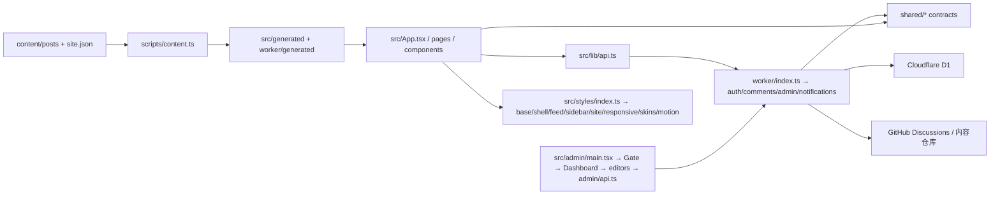
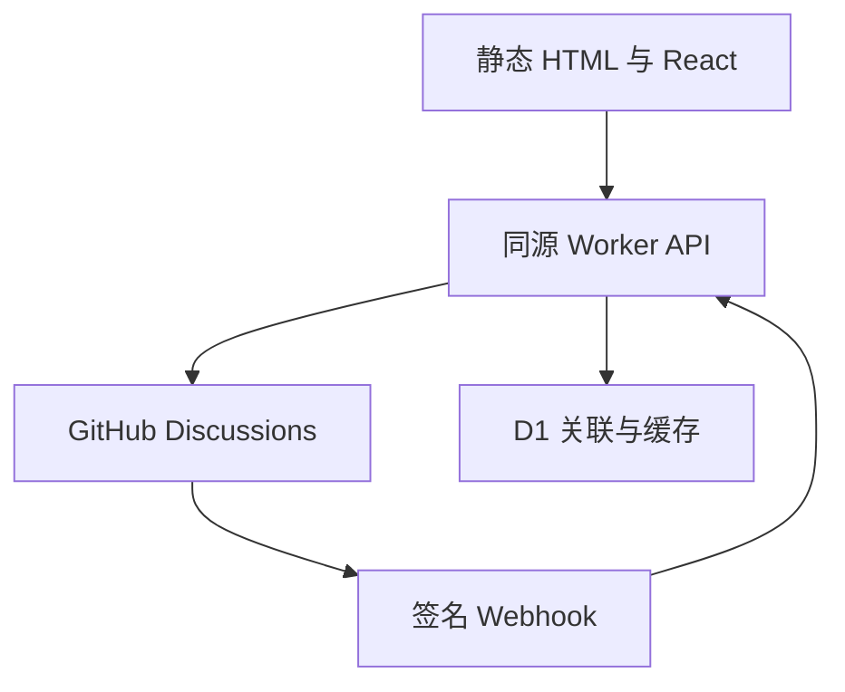

# 架构、API 与数据边界

## 模块职责与故障定位地图（维护规划，2026-11-05）

> 本节区分 **当前代码已存在的事实** 和 **未来渐进改造的目标**。现有 API、数据库和离线预览契约仍以本文后半部分为准。本节只规定维护边界，不代表下述建议目录已经实施。操作、PR、记录模板见 [维护手册](MAINTENANCE.md)。

### 当前请求链和依赖方向



- **浏览器路由及页面装配**：`src/App.tsx`、`src/pages.tsx`、`src/pages/*`。`src/components/*` 实现 UI，`src/lib/*` 提供面向浏览器的路由、动效、公共 JSON API、选区和本地持久化能力。
- **后台**：`src/admin/main.tsx` 仅管理主题同步与挂载；`src/admin/Gate.tsx` 独立管理登录会话、CSRF 初始化及权限提示；`src/admin/Dashboard.tsx` 负责页面切换、部署状态和请求刷新；`src/admin/ContentList.tsx` 只负责文章列表与删除；`src/admin/Discussions.tsx` 单独负责评论区初始化及批处理终止条件；`PostEditor.tsx`、`SiteEditor.tsx` 分别拥有编辑状态与保存事务。共同通过 `src/admin/api.ts` 保留认证、CSRF、专有超时，不与缓存型公开浏览 API `src/lib/api.ts` 混用。
- **服务端**：`worker/index.ts` 只组织入口及路由；`worker/auth.ts`、`security.ts`、`comments.ts`、`admin.ts`、`notifications.ts`、`views.ts` 分别管理相关责任；后台源码仓库的 GitHub GraphQL/REST 访问、分支 OID 与单次原子提交在 `worker/admin-repo.ts`，`worker/admin.ts` 保留鉴权、输入校验和 API 编排；跨端合同放 `shared/*`。
- **数据生产线**：`content/*` 为文章/站点配置源；`scripts/content.ts` 构建 `src/generated/*` 与 `worker/generated/*`；不要直接手改生成产物、历史 D1 migrations 或已发布的 `post.id`。
- **样式与动效**：`src/styles/index.ts` 是正式/离线共用的字体和 CSS 导入顺序；`src/styles.css` 是阅读器与基础规则；`src/styles/shell.css`、`feed.css`、`sidebar.css`、`site.css` 分别负责页眉首页、信息流、侧栏、索引/页脚；`responsive.css` 负责跨页面断点；`skins.css` 是双皮肤主题覆盖；`motion.css` 负责动画与可访问性动效规则；运行时动画策略在 `src/lib/motion.ts`。
- **验证和部署**：`tests/*` 是单测与契约测试；`scripts/*-smoke.mjs` 为真实浏览器审核；`.github/workflows/verify.yml` 是唯一 GitHub Actions 入口，按 `scripts/ci-plan.mjs` 选择检查。

依赖应单向：`App / pages → components → lib → shared`；`worker 路由 → worker 业务模块 → shared`。`shared` 不应依赖 React、浏览器 DOM、Worker 运行时、GitHub 客户端或 D1；前端业务代码不得直接连接 D1、使用服务器 Token，服务端也不得 import 浏览器组件。跨端交互走版本稳定的 HTTP/共享类型，不允许跨功能深层 import 内部私有实现。

### 从问题直接找到文件

**先查入口模块和相邻依赖，再扩大搜索范围。** 表中是排查起点，不保证每次故障都由该文件引起。涉及数据、权限、生成文件时按请求链向上或向下追踪。

| 用户反馈 / 故障类型 | 第一定位路径 | 关联检查（仅在影响范围内运行） |
| --- | --- | --- |
| 三端两主题排版、标题换行、导航或留白 | `src/styles/shell.css`（页眉与首页）、`src/styles/feed.css`（条目）、`src/styles/responsive.css`（断点）、`src/styles/skins.css`（皮肤）；阅读页见 `src/styles.css`；组件 DOM 在 `src/App.tsx` / `src/components/Feed.tsx` / `Reader.tsx` | `tests/mobile-regressions.test.ts`、`tests/skin-parity.test.ts`、`scripts/visual-smoke.mjs`、`scripts/responsive-navigation-smoke.mjs` |
| 搜索、URL 筛选、排序、返回位置 | `src/pages/Feed.tsx`、`src/components/Feed.tsx`、`src/lib/router.tsx`、`src/App.tsx` | `tests/navigation.test.ts`、`scripts/interaction-state-smoke.mjs` |
| 文章阅读、目录、代码块、图片放大 | `src/components/Reader.tsx`、`MarkdownTools.tsx`、`src/lib/reader-loader.ts` | `scripts/reader-deep-smoke.mjs`、`scripts/quality-smoke.mjs` |
| 长按选区、私人划线、批注定位与分享 | `src/components/Reader.tsx`、`src/lib/selection.ts`、`shared/anchors.ts` | `tests/selection.test.ts`、`tests/anchors.test.ts`、`scripts/selection-composer-smoke.mjs` |
| 评论加载、提交、重试及缓存 | `src/lib/api.ts`、`worker/comments.ts`、`worker/github.ts`、`worker/auth.ts` | `tests/worker.test.ts`、`tests/transport.test.ts`；必要时跑阅读器浏览器检查 |
| 登录、CSRF、安全头和权限 | `worker/auth.ts`、`worker/security.ts`、`worker/index.ts`、`worker/types.ts` | `tests/worker.test.ts`、`tests/github-app-config.test.ts` |
| 后台登录、管理看板、编辑内容、媒体上传与站点设置 | `src/admin/main.tsx`（启动）→ `Gate.tsx`（会话）→ `Dashboard.tsx`（路由与刷新）→ `ContentList.tsx`（内容列表） / `Discussions.tsx`（评论区创建） / `PostEditor.tsx` / `SiteEditor.tsx`（表单事务）；通用能力在 `ui.tsx` / `helpers.ts` / `form.ts` / `api.ts`；服务端入口 `worker/admin.ts`（权限、API、数据校验）→ `worker/admin-repo.ts`（内容仓库读写/版本） | `tests/admin-modules.test.ts`、`tests/admin.test.ts`、`tests/admin-repository.test.ts`、`tests/admin-form.test.ts`、`scripts/quality-smoke.mjs` |
| 文章新增、永久链接、RSS 和预渲染 | `content/*`、`scripts/content.ts`、`scripts/prerender.tsx`、`shared/redirects.ts`、`worker/post-sync.ts` | `tests/post-sync.test.ts`、`tests/redirects.test.ts`、`scripts/check-build.ts` |
| 深浅主题、editorial / terminal 和动效 | `src/styles/skins.css`、`src/styles/motion.css`、`src/lib/appearance.ts`、`src/lib/motion.ts` | `tests/skin-parity.test.ts`、`tests/motion.test.ts`、`scripts/quality-smoke.mjs` |
| 通知状态、阅读清单与浏览量 | `src/components/NotificationBell.tsx` / `Shelf.tsx`、`src/lib/shelf.ts` / `views.ts`、`worker/notifications.ts` / `views.ts` | 相关单测、`scripts/quality-smoke.mjs` |
| Actions 消耗、测试分类与手动运维 | `.github/workflows/verify.yml`、`scripts/ci-plan.mjs`、`scripts/maintenance.test.mjs`；策略见 `docs/ops/ACTIONS_POLICY.md` | `node --test scripts/maintenance.test.mjs`，必要时手动全套 CI |
| 部署、D1 迁移与仓库转私有 | `wrangler.jsonc`、`scripts/validate-deploy.ts`、`migrations/*`、`worker/auth.ts`；清单见 `docs/MAINTENANCE.md` | `npm run check`、真实 Worker 验证、受控发布与回滚检查 |

### 阅读器拆分第一批（已合并，PR #101）

阅读器的公开入口仍为 `src/components/Reader.tsx`，由 `src/lib/reader-loader.ts` 按需加载；路由、全文状态、提交、Touch 选区和评论写入协议保持原位。新增两个**按功能划分**的入口：

| 功能 | 稳定入口 | 内部实现及责任 |
| --- | --- | --- |
| 文章头部与目录 | `src/features/reader/index.ts` | `ArticleHeader.tsx`（文章元信息和返回动作）、`ReaderToc.tsx`（目录/阅读进度/状态展示）、`ImageViewer.tsx`（图片放大与退出动画保留） |
| 公开评论显示 | `src/features/discussions/index.ts` | `CommentItem.tsx`（回复分页、编辑/删除按钮）、`CommentMarkdown.tsx`（公开评论与草稿共用的安全 Markdown）、`model.ts`（空评论过滤与 GitHub URL 限制） |

- `CommentItem` 通过 `postId`、`comment`、`onReply`、`onQuote`、`onChanged` 等显式输入接收上下文，**不再**使用 `useRouter` 和全局文章表猜测当前文章；递归回复沿用同一 `postId`。新增评论能力可优先修改 `features/discussions` 而不修改导航逻辑。
- `ReaderToc` 从父组件接收当前段落、阅读进度和控制回调；实际 DOM 位置与跳转时机仍由 `Reader` 负责，避免目录直接操作不属于它的生命周期。
- 组件对外渲染结构、CSS class、永久链接、评论 API、D1、离线预览和动效策略不变。未新增第三方 UI / 动画 / 状态管理依赖。
- CI 的 `scripts/ci-plan.mjs` 已将 `src/features/reader/`、`src/features/discussions/` 及后续 `annotations/` 映射至阅读器相关 QA；新功能只需接入对应入口及契约测试，不必创建新工作流。
- 当前 Reader 仍含选区与评论编辑器的复杂生命周期；**未擅自将这些状态强拆**。后续要抽离其中一个必须先建立独立行为基线，重点覆盖 Safari 长按、评论草稿恢复和错误提交重试。

### 阅读器增量解耦 A（2026-11-06，已合并 PR #108）

- **根因**：此前 `Reader.tsx` 的滚动事件、进度持久化、目录高亮、返回定位与选区/评论状态耦合；独立的滚动观察职责不能单独定位或复测。
- **边界**：`src/features/reader/useReadingProgress.ts` 接收文章与 DOM refs，独占滚动监听、requestAnimationFrame、阅读进度/目录高亮、`echo:reading` 存储和 `?resume=1` 恢复；`Reader` 只消费其状态并传入稳定的选区取消 setter。保持原事件注册条件、滚动计算、保存时机与优先选区规则。
- **刻意保留**：长按/双击、触摸选区、CSS Highlight、浮动工具手势、目录弹层焦点、评论草稿与发送状态、图片放大仍在原控制路径；它们与 Safari 原生手势/弹窗时序紧密相关，缺少真实设备证据前不进行联合重构。
- **验收**：在原 Waylan CI 执行 `npm run check`、阅读器/返回滚动/目录、iOS 模拟触摸、三引擎与布局回归。WebKit 模拟不能证明真实 iOS Safari 已通过；不改变 API、数据、URL、CSS、构建与工作流。[PR #108](https://github.com/YohakuSama/waylan-blog/pull/108) 已通过 [Waylan CI #42072965186](https://github.com/YohakuSama/waylan-blog/actions/runs/42072965186)，squash 合并 SHA `aa52f770`；生产验证尚无证明。

### 后台模块化第二批（已合并，PR #102）

现有管理后台是独立入口 `/admin`，并没有引入新的管理框架。本次保留所有提交与上传协议、CSS、前端表单 DTO 及原始 API 路径，仅将原约 1,286 行的 `src/admin/main.tsx` 依责任切分：

| 维护问题 | 唯一主要修改路径 | 依赖与风险 |
| --- | --- | --- |
| 后台无法启动、主题同步 | `src/admin/main.tsx` | 只挂载 React、同步主题，不发起业务请求 |
| 登录与权限提示、会话无法获取 | `src/admin/Gate.tsx` | 通过 `setAdminCsrf` 和 `adminApi` 初始化会话，不在客户端模拟权限控制 |
| 站点概览、部署进度与视图切换 | `src/admin/Dashboard.tsx` | 负责异步刷新序号与编辑器 `onSaved` / `onClose` 回调，不处理每条内容的删除状态 |
| 内容列表搜索、单条内容删除 | `src/admin/ContentList.tsx` | 列表与删除确认统一走 `admin/api.ts`，不复制看板刷新逻辑 |
| 初始化缺失的 GitHub Discussions 评论区 | `src/admin/Discussions.tsx` | 批处理最多 50 轮，服务器明确报告剩余量为 0 才算成功；无进展或上限触发明确错误，不重试到资源耗尽 |
| 文章撰写/保存、发布日期、slug、上传图片、草稿 | `src/admin/PostEditor.tsx` | 使用 `form.ts` 的 `toForm/toData`、`helpers.ts` 的上传校验；不自行操作 GitHub Token |
| 站点头像、标签、介绍、联系方式、关于页 | `src/admin/SiteEditor.tsx` | 一个站点表单和一次保存事务；保留原来的 `/api/admin/site` 路径 |
| 后台字段、Markdown 预览、确认对话框 | `src/admin/ui.tsx` | 两种编辑器复用一套 UI/图片选择逻辑，CSS class、DOM 语义保持 |
| 本地图片校验、大小限制、上传去重、未保存警告、Ctrl+S | `src/admin/helpers.ts` | 与 `shared/uploads.ts` 的类型校验契约相连，避免每个编辑器重复实现 |
| API JSON、CSRF、保存超时 | `src/admin/api.ts` | 与公开只读缓存客户端分离，禁止 UI 直接 `fetch` 绕过它 |
| 管理数据类型和视图 DTO | `src/admin/types.ts` | 前端内部类型，不擅自变更 Worker 响应或 D1 Schema |

**功能增减规则：** 新增后台页面优先在 `Dashboard.tsx` 注册一个独立视图，并用具名 props / 回调连接新模块；只有跨文章/站点编辑器真正一致的 UI/校验才归 `ui.tsx` / `helpers.ts`。新增管理数据调用必须走 `admin/api.ts`，不得从 `Gate.tsx` 或 `main.tsx` 绕过 CSRF，也不得在组件间相互引用彼此的内部表单状态。每次变更同时更新本表对应故障入口、`tests/admin-modules.test.ts`（边界）及关联权限/写入回归，继续使用唯一 `Waylan CI`，不增加工作流。

**第二阶段增量完善：** 将原来同时包含内容列表与评论区创建的 `ContentList.tsx` 拆出 `Discussions.tsx`；批处理不再把超过 50 轮或无进展的操作当成完成，避免高频无效请求和虚假成功通知。`Dashboard` 只修改模块 import；既有后台 API、CSRF、权限、CSS、数据库、内容保存协议不变。相关异常路径用 `tests/admin-modules.test.ts` 的纯逻辑测试覆盖。

**内部依赖方向：** `main → Gate → Dashboard → ContentList/Discussions/PostEditor/SiteEditor → ui/helpers/form → types`；所有 API 调用从各层统一走 `admin/api`。依赖应避免反向从 Editor 访问 Dashboard 内部状态；扩展新后台页面在 Dashboard 增加视图分发和明确的回调，不必修改认证入口。

**不变量：** 发布文章 `post.id`、301 slug 规则、图片限制、同源 CSRF、GitHub 乐观并发 OID、Cloudflare 构建语义、草稿未保存警告和编辑器快捷键均保持旧逻辑。本次不变动 Worker、数据库、依赖、Admin CSS 或打包入口。

**回归与回滚：** `tests/admin-modules.test.ts` 审核模块边界；`tests/admin-form.test.ts` 检查表单规则；`tests/admin.test.ts` 检查真实 Worker 写入/权限/冲突；`scripts/quality-smoke.mjs` 验证跨浏览器的后台交互。PR [#102](https://github.com/YohakuSama/waylan-blog/pull/102) 的头部提交 `7edeb4f0` 已通过 [Waylan CI #42044394381](https://github.com/YohakuSama/waylan-blog/actions/runs/42044394381)：类型检查、构建、单元/契约测试、多端布局、Chromium/Firefox/WebKit 后台交互和 WCAG；合并提交 `49de396e` 的 [main 核心检查 #42045915291](https://github.com/YohakuSama/waylan-blog/actions/runs/42045915291) 亦通过。本次按需分类正确跳过与后台无关的阅读器、摘录、动效专项。**生产环境 OAuth、真实 GitHub 写入/上传、Cloudflare 部署尚未单独验收。** 如出现回归，可回滚本次前端重构并重新部署；本 PR 无数据库迁移，因此无需反向迁移 D1。

### 第三阶段 CSS 责任边界（首批，已验收合并 PR #105）

> 单一入口：`src/styles/index.ts`。在线/离线同时加载它；不要直接在单个组件 import 此处的功能样式，更不能把覆盖规则追加到任意文件尾部。

| CSS 模块（按级联顺序） | 负责内容 | 最先追踪的组件 / 文档 |
| --- | --- | --- |
| `src/styles.css` | 基础颜色/字阶、阅读器、对话框、评论编辑区 | `src/components/Reader.tsx`、`docs/DESIGN_SYSTEM.md` |
| `src/styles/shell.css` | 页面外壳 token、页眉、首页介绍与搜索/切换控件 | `src/App.tsx`、首页组件 |
| `src/styles/feed.css` | 内容卡片结构、缩略图、摘要与列表基础规则 | `src/components/Feed.tsx` |
| `src/styles/sidebar.css` | 首页及索引的统一侧栏/目录结构 | `src/components/Sidebar.tsx`（如有分布在页面组件，以实际 JSX 为准） |
| `src/styles/site.css` | 归档/项目/关于等索引页、页脚、阅读页和站点外壳对齐 | `src/pages/*`、页脚/阅读组件 |
| `src/styles/responsive.css` | 跨页面的 1280/1120/860/767/700 等断点布局及手机信息流密度 | `docs/RESPONSIVE_LAYOUT.md` 与实际页面 DOM |
| `src/styles/skins.css` | editorial / terminal 的配色、字体和必要差异覆盖 | `docs/DESIGN_SYSTEM.md` |
| `src/styles/motion.css` | 转场、悬停、键盘/触摸反馈和减少动效 | `src/lib/motion.ts` |

**按需修改规则：** 单个组件的样式改动先查对应负责文件，再查 `responsive.css`，需要区分皮肤才查 `skins.css`，动效问题最后查 `motion.css`。不要把 `--header-height` 一类布局 token 的修复仅写进 skin；此类值必须跨皮肤共享。新拆分不得移动规则到相反的导入位置，以免同优先级覆盖出现相反结果。此表不代表已完成所有重复样式清除；本批只处理了顺序可证明保持的边界与两组被完全覆盖的手机标题规则。

**回归基线：** `tests/css-ownership.test.ts` 约束导入次序和明确责任，`tests/skin-parity.test.ts` 按真实拥有者查找规则；`npm run check` 和 `scripts/visual-smoke.mjs` 检查打包、离线预览和跨皮肤/跨屏宽几何。涉及 CSS 的 PR 必须明确说明原始规则顺序和其后覆盖关系。

### 第四阶段 Worker 后台仓库访问边界（首批已合并，PR #106）

```text
HTTP request → worker/index.ts → worker/admin.ts
                                    ├─ requireAdmin/session + CSRF/origin（沿用原入口）
                                    ├─ payload/content/site/upload validation
                                    ├─ admin-repo.ts → GitHub REST/GraphQL / branch HEAD / blobs / tree / commit
                                    └─ syncDiscussions → 现有公开 GitHub Discussions + D1
```

| 处理的问题 | 第一责任文件 | 不得绕过的合同 |
| --- | --- | --- |
| 后台账号和内容权限、403/503、安全错误 | `worker/admin.ts` → `worker/auth.ts`、`worker/security.ts` | 原身份会话、CSRF、同源/速率限制顺序 |
| 获取内容仓库分支版本、枚举文章、读取/查找内容 | `worker/admin-repo.ts` 的 `repo/head/posts/files` | GitHub GraphQL 仓库与分支、404、OID 和版本检查 |
| 文章/站点写入、图片 blob、提交冲突 | `worker/admin-repo.ts` 的 `commit/blobOid`；调用方在 `admin.ts` | Git Data REST 的 base tree → commit → 非强制更新 HEAD；409 冲突、403 token 错误映射；不可变 `post.id` |
| 公共评论加载、批注映射与写入幂等恢复 | `worker/comments.ts`、`worker/github.ts` | 不与后台 GitHub **内容仓库**混用 token、缓存或重试流程 |
| 公开 Discussions 创建和 D1 登记 | `worker/admin.ts` 的 `syncDiscussions`（当前仍在编排层） | 管理员权限、D1 发布文章映射、公开仓库验证，每次不超过 10 篇 |

此次把 `worker/admin.ts` 的 ~190 行完整 GitHub 内容仓库 I/O 放到 `admin-repo.ts`，不生成第二份 GitHub 客户端，不将私有内容 Token 混入公共评论访问 `worker/github.ts` 的调用路径；`worker/github.ts` 仍是现有通用 GraphQL transport。移动代码不改变任何请求或提交次序。新增 `tests/admin-repository.test.ts` 覆盖分支选择、空请求与 UTF-8 Git blob OID，原 `tests/admin.test.ts` 继续验证令牌失败、并发冲突、上传与不可逆写入。**后续拆分必须以独立 PR 进行，不能在这个提交中更改评论的幂等写入语义。**

**首批验收记录：** [PR #106](https://github.com/YohakuSama/waylan-blog/pull/106) 已合并至 `main`，squash 提交 `0708fa5b`。PR head `f5263384` 的 [Waylan CI #42065361326](https://github.com/YohakuSama/waylan-blog/actions/runs/42065361326) 全部通过：类型检查、构建、单元/Worker 合约、预渲染和离线产物、多端视觉、Chromium/Firefox/WebKit 后台交互、WCAG，以及信息流状态机回归。视觉测试曾因通知服务状态切换的多重路由模拟出现超时，已调整为单一可切换 Mock 并保留原断言，最终复测通过。Cloudflare 真实部署、生产 OAuth 及真实 GitHub 内容写入**尚未确认**。

### 评论 Worker 读写边界 B（2026-11-06，已合并 PR #109）

- **修改前**：`worker/comments.ts` 同时承担读取聚合、缓存、D1 批注绑定、仓库验证、公开预览、写入幂等/恢复、编辑与删除；单个文件很难在不影响写入事务的前提下审查只读逻辑。
- **改动后**：`worker/comment-reads.ts` 拥有评论分页、单条、回复、信息流预览、批注分页、最近回声与 `attach`；`worker/comment-shared.ts` 拥有文章存在性、游标、公开 Discussion 仓库验证以及空页合同；`worker/comments.ts` 保留写入、审查权限与 `requestId` 恢复状态机，并作为原路由的稳定导出入口。依赖方向：`worker/index.ts → comments.ts → comment-reads.ts → comment-shared.ts`，写入与读取都调用共享校验模块；共享模块不反向依赖其他评论服务。
- **安全的冗余**：删除 feed preview 中只原样 `throw error` 的无效 catch；错误仍直接传播，绝不将网络或权限失败伪装为零评论。原有 `github.ts` 的 GraphQL、cacheGet、缓存键和过期/旧缓存逻辑原样复用，未增加另一套包装器。
- **不变合同**：所有 HTTP 路径/状态码、JSON 结构、OAuth 用户 token、CSRF、公开仓库核验、D1 表与批处理、Reply 元数据、Webhook 清缓存不动；`sending/sent/failed` 意图状态、哈希、保留/恢复窗口、发送后失败分类、重复提交拒绝均保留原始实现，未改排序。
- **验证界限**：`tests/worker.test.ts` 使用真实 SQLite 结构、模拟 GitHub transport，覆盖 401/403、缓存、断线重试/同 ID/不同 ID、Webhook；新增依赖边界断言。Waylan CI 检查类型、构建、单元/浏览器；不等于生产 GitHub 与 D1 真正写入验收。[PR #109](https://github.com/YohakuSama/waylan-blog/pull/109) 已在同步 A 后的 head `c53ce4e1` 通过 [Waylan CI #42075026817](https://github.com/YohakuSama/waylan-blog/actions/runs/42075026817)，squash 合并 SHA `1a21bb9d`。

### 目标模块组织（渐进方案，**仅部分实施**）

先在现有组件内确认独立状态和事件边界；有必要时逐个功能迁移到以下目录，而不是一次迁移整个项目。示意：

```text
src/
  app/                 路由装配、页眉/搜索/全站状态（从 App 局部提取）
  pages/               保留独立页面和稳定路由入口
  features/
    reader/            阅读容器 / 目录 / 封面 / 阅读进度
    annotations/       选区、私人划线、定位、浮动工具
    discussions/       评论 UI、草稿、分页与发送状态
    feed/              列表、筛选、排序与推荐
    admin/             后台编辑器、站点编辑、内容列表
  lib/                 跨功能且与业务无关的轻量基础能力
  styles/              tokens / base / layout / features / skins / motion
worker/
  index.ts             入口与路由分发
  auth.ts / security.ts / ...    原有服务边界先保持
shared/                跨前后端的类型、定位、输入规则
```

**迁移规则：** 只在改动相应功能且有验证环境时动一块；外部继续通过稳定的模块入口引用；内部实现原则上不跨功能深层导入。若出现为复用两行代码而创建新的三层抽象，通常应保留局部实现；真正共用且策略一致的能力再提升至 `lib/` 或 `shared/`。

建议优先顺序及约束：

1. **P0｜建立地图和变更记录（已完成）**：为模块建立归属、影响半径、异常定位和维护报告，无业务改动。
2. **P1｜阅读器拆分（第一批已迁移）**：原 `src/components/Reader.tsx` 约 2,234 行，首批抽出文章头部、目录、图片放大和评论显示；保留 `Reader({ post })` 外部签名、评论 ID、批注锚点和返回行为。增量 PR #108 已进一步把滚动进度、活动目录状态和 `resume=1` 返回位置迁到 `src/features/reader/useReadingProgress.ts`；复杂触摸选区、评论草稿及发送状态保留原职责，未为缩短文件强行拆分。
3. **P2｜后台编辑器拆分（本批已实施）**：`src/admin/main.tsx` 仅保留后台挂载与主题，`Gate.tsx` 单独负责认证闸门，`Dashboard.tsx` 负责管理视图、`ContentList.tsx` 负责内容列表、`Discussions.tsx` 负责评论区初始化，`PostEditor.tsx` 与 `SiteEditor.tsx` 分别负责自己的状态和保存。现有 `admin/api.ts`、表单规则、上传事务和 Worker API 均保持兼容。
4. **P3｜CSS 归属与级联清理（首批实施）**：先把原 `site.css` 按顶层规则段落顺序拆分为 `shell.css`、`feed.css`、`sidebar.css`、`site.css`、`responsive.css`，保持已存在的 `styles.css → site → skins → motion` 原始相对级联次序；删除两组被最终手机标题声明完全覆盖的旧规则。`styles.css` 的阅读器与基础规则、双皮肤覆盖暂不搬动；未来清理必须先检查原选择器的 @media 作用域、优先级及导入顺序，且实测手机、平板、桌面、明暗模式。
5. **P4｜Worker 读写职责分离（首批已合并，PR #106）**：先将 `worker/admin.ts` 中的 GitHub 内容仓库 REST/GraphQL、OID 读取、文件读取和原子 commit 完整移至 `worker/admin-repo.ts`，保留 `worker/admin.ts` 的身份/管理员鉴权、校验和 API 编排。随后 PR #109 将评论读取与 D1 批注关联迁到 `worker/comment-reads.ts`、文章/仓库来源校验迁到 `worker/comment-shared.ts`；`worker/comments.ts` 的写入、重复提交恢复与管理权限状态机完整保留。**不得**同时改 HTTP 协议、D1 迁移、OAuth 安全约束及评论的重复提交恢复语义。
6. **P5｜测试维护结构**：`tests/navigation.test.ts` 等大文件可按功能和夹具拆分，但先锁定测试数、场景与历史缺陷清单；拆分后不得少测。`scripts/ci-plan.mjs` 应随入口移动同步更新，否则会误判变更范围。

行数是**审查信号，不是重构 KPI**。可以用“文件是否只有一个清晰的变更理由”“一次修改影响哪些功能”“能否单独回滚”判断是否应该拆分。避免把 1 个大文件机械切成 30 个相互依赖的小文件。

### 依赖图算法与智能化边界

- 优先使用简单、确定性且可审计的依赖图：TypeScript import / export 与动态加载入口构成有向图；用拓扑排序判断层级，用强连通分量（如 Tarjan）识别循环依赖，用有限深度遍历寻找 PR 变更的影响范围。
- 图谱可在**结构变更/定期审计**时生成，保存版本和生成时间；平时故障按上面的定位表寻找责任目录，不要求每次全仓扫描。
- 神经网络/AI 可用于**提示可能关联的模块、总结异常和建议测试**，不得代替确定性的依赖解析、类型检查、权限判断和合并门禁。当前项目没有必要因此引入新的运行时 AI 框架或服务费用。
- 后续如实现依赖图生成器，先给它设定可验证的目标：没有漏掉静态依赖、循环依赖有报告、动态 import 需要人工标记、报告可追溯到 commit；未达到要求不将其作为自动决定 QA 的依据。

### 验收指标与不可变契约

每次结构性 PR 必须有基线及对比：相关测试不减少、前端预渲染/离线预览不回退、API 状态码/错误合同不漂移、`post.id` / Discussion / annotation / OAuth / D1 数据兼容、两皮肤两主题关键布局坐标不改变（除非目标明确要求）。记录首次定位时间、跨模块修改数量、复发率、受影响文件和 CI 使用量；**真实指标优先于文件数或代码行减少量**。

遵循基于风险的安全开发流程；可参考 [NIST SSDF SP 800-218](https://csrc.nist.gov/pubs/sp/800/218/final) 的安全需求、设计决策追踪和漏洞响应原则，但本项目并未宣称取得任何标准认证。

## 请求与持久化



构建时把 Markdown 转为消毒后的 HTML 和稳定块数据，再对所有公开路由渲染完整 HTML。客户端阅读模块单独分包，进入文章前加载；服务端预渲染直接使用该组件，绝不把 Suspense 占位当正文交付。

Workers Static Assets 优先处理文章和图片；`/api/*` 才 `run_worker_first`。没有 SPA 404 fallback，未知文章由真实 404 文档处理。`_headers` 对静态内容设置 CSP 等安全头；API 自己设置响应头。前端构建不接收任何带密钥的 VITE_* 环境变量。

## API

| 方法 | 路径                                                   | 说明                                                 |
| ---- | ------------------------------------------------------ | ---------------------------------------------------- |
| GET  | `/api/status`                                          | 只返回配置就绪状态，不返回配置值                     |
| GET  | `/api/session`                                         | 当前身份与 CSRF Token；未登录返回 user:null          |
| GET  | `/api/auth/github?return=...`                          | 一次性 state、PKCE，跳转 GitHub                      |
| GET  | `/api/auth/callback`                                   | 验证 state，交换用户 Token，建立 HttpOnly 会话       |
| POST | `/api/logout`                                          | 同源、会话、CSRF 校验后撤销会话                      |
| GET  | `/api/feed/comments?ids=...`                           | 最多 20 篇，批量查询每篇最近两条主评论               |
| GET  | `/api/echo`                                            | 最近真实站内提交，跳过已删除内容                     |
| GET  | `/api/posts/:id/comments?after=...`                    | 每页 20 条主讨论，附前 3 条回复                      |
| GET  | `/api/posts/:id/comments/:commentId`                   | 批注深链定点读取，校验所属 Discussion                |
| GET  | `/api/posts/:id/comments/:commentId/replies?after=...` | 每页 20 条回复                                       |
| GET  | `/api/posts/:id/annotations?after=...`                 | 每页 100 个批注元数据，向 GitHub 验证存在性          |
| POST | `/api/posts/:id/comments`                              | 用户 Token 发表，支持 anchor、replyToId 和 requestId |
| POST | `/api/webhook/github`                                  | HMAC SHA-256 校验、缓存失效、删除同步                |

UI 的“条讨论”数量指 GitHub 顶层 DiscussionComment 数量；回复在各线程内单独分页计数，不把一个不完整的回复合计伪装为总评论数。

## D1 表

| 表            | 存什么                                                    | 不存什么                  |
| ------------- | --------------------------------------------------------- | ------------------------- |
| posts         | 稳定 ID、slug、标题、当前内容版本                         | 文章正文仍在 Git Markdown |
| discussions   | 文章 ID 与真实 Discussion ID/number/URL                   | 不伪造节点 ID             |
| annotations   | GitHub comment ID 与 selector JSON                        | 不代替 GitHub 评论正文    |
| api_cache     | 最长 60 秒的新鲜展示缓存，最多 15 分钟故障缓存            | 不是正文权威来源          |
| sessions      | Cookie 哈希、用户身份、AES-GCM 加密 Token、CSRF、到期时间 | 不存明文 OAuth Token      |
| oauth_states  | state 哈希、加密 verifier、安全返回路径、10 分钟过期      | 不接受任意外部返回地址    |
| rate_limits   | 短期哈希桶与原子计数                                      | 不长期保存原始 IP         |
| write_intents | 提交 ID、payload 哈希、状态与 GitHub 结果 ID              | 不把本地成功当成远端成功  |

每日定时清理过期会话、OAuth 状态、限流桶、过期缓存和超过 90 天的提交意图。永久批注不随清理删除。

### 已发布文章、永久链接与 D1 自动对账

- 发布后的 `post.id` 不变；后台更改 `slug` 时，与 Markdown 同次提交更新 `public/_redirects` 的 301 规则。重复更名将旧来源直接指向当前地址；旧来源不允许被另一篇文章占用。Workers Static Assets 原生执行这些规则，前端不拦截不存在于当前文章清单的链接。
- GitHub/Cloudflare Workers Builds 仅负责构建和 Worker 部署，**不自动执行** `wrangler d1 execute`。Worker 在部署后首个具备 D1 的 API 请求、及每天的定时任务，以打包进 Worker 的 manifest 校准 `posts` 的 slug、title、version；变更在 D1 batch 中原子执行，允许两篇文章互换 slug。
- 同步失败记录不含个人信息的 `post_catalog_sync_failed` 事件，评论 API 继续按现有数据服务，并在后续请求重试；运维需查看 Worker Logs。文章删除或下架后，D1 历史记录、稳定 `id`、Discussion 和批注关联仍保留；若当前已发布文章需要使用历史 `slug`，同步会在**同一事务内**将原历史行改用 `__retired__<post.id>` 内部占位 slug，再为现行文章分配该地址。占位名包含下划线，不可能成为公开文章 slug。这个过程不删除关联数据；恢复原文章时使用同一个 `id` 可重新绑定其公开 slug。
- 手动部署运行迁移后直接部署 Worker，自动对账取代部署前的 D1 SQL 写入。现有 `db:sync:remote` 命令保留给人工校验、恢复，以及**首次手动导入新增文章的 Discussion 映射之前**建立外键目标；手动进行 slug 互换时避免使用旧版单阶段 SQL。

每日定时清理不会删除旧文章的讨论或批注。

## 发表评论与不确定结果

1. 服务端确认同源、用户会话、CSRF、文章、原文定位、Discussion 公共仓库归属和回复对象。
2. 原子保留 requestId 与 payload 哈希。已成功的相同请求直接读取原结果；相同 ID 配不同正文被拒绝。
3. 只使用该用户自己的 OAuth Token 调用 addDiscussionComment。隐藏 HTML 注释携带文章 ID、requestId 和可恢复 selector。
4. GitHub 返回后，在 D1 batch 中保存 selector、标记发送成功并失效该文章缓存。
5. 如果网络断在 GitHub 写入之后，状态为未确认；下次以同一 requestId 在最近 100 个根评论及各自最近 100 个回复中寻找隐藏标记。找到后补齐 D1，绝不自动再发一条。

这个恢复窗口适合个人博客。超过窗口、用户删除了隐藏标记、仓库在请求期间被锁定或网络始终失败时，需在 GitHub 原讨论确认，不能承诺分布式系统中的无限次“恰好一次”。UI 保留草稿并清楚提示未确认。

## 持久划线

selector 包含 schema、postId、version 与多个 segment。每段保存 blockId、TextQuoteSelector(exact/prefix/suffix) 与 TextPositionSelector(start/end)。UTF-16 位置与浏览器 DOM Range 一致。

定位顺序：准确原文匹配 → 同版本稳定位置 → 前后文与稳定块 ID 得分 → 拒绝歧义。不会模糊替换成另一句“类似的话”。跨段选择必须所有段都定位成功，否则整条批注进入无法定位状态。多个高亮先分割成不重叠区间，再对实际文本节点加 mark，每个 mark 保留所有关联 ID，内联粗体与链接结构不被拆坏。

公开选择的引用来自 GitHub 评论对应的 D1 元数据；推荐流、批注深链、原文高亮和讨论引用使用同一 comment ID。个人划线是明确说明的本机功能，与公开批注持久化区分。

## 缓存与同步

GitHub 读取按文章、分页游标、讨论 ID 缓存。本人提交后立即失效该文章缓存；Webhook 编辑/删除后同样失效。没有 Webhook 时正常刷新最多落后 60 秒。只在临时上游失败时允许带 stale 标记的旧缓存；删除、权限不足和私有仓库不会主动触发故障缓存回退。

安全配置变更应同时清理对应缓存；将曾公开的仓库改为私有时，应立即停用公开 API 或清理缓存，因为任何 TTL 缓存都有生效窗口。本项目要求专用的公开 Discussions 仓库。

## 扩展与运维

- 评论权限与屏蔽以 GitHub 为准；代码不提供越权编辑/删除。
- API 错误只记录路径和错误码，不记录请求 Header、Token、OAuth code 或评论文本。
- Cloudflare D1 备份及 GitHub 仓库是运维备份边界；不要仅依赖浏览器保存批注关系。
- 自定义域名必须保持同源，Cookie 不跨 workers.dev 与自定义域共享。
- 正式 OAuth、GitHub 配额和 Cloudflare 域名证书需要部署后的真实环境验收。

## 可双击的离线构建

`src/offline.tsx` 经 Vite library build 输出单一 IIFE，CSS、SVG 与 RSS 一并内嵌到 `preview/index.html`。该文件用 file:// 直接执行，采用 fragment 地址，不要求本地服务器。正式客户端仍保留独立 URL 与按需阅读模块。

预览有清晰的离线标记；只读状态返回“未连接”，公开登录和发帖不可用。私人划线、搜索、筛选、阅读与主题是真实的本地交互。所有公开评论在正式 HTTP 部署中继续走原来的 Worker/GitHub/D1 链路。

已有文章 ID、批注 ID、深链前缀和存储键保持兼容。ECHO 仅作为早期工程的数据命名空间保留，不再作为对外站名。实际域名仍须由站长填写完整 FQDN，不能把 Waylan 自动猜作某个 .com 或 .cn 地址。
